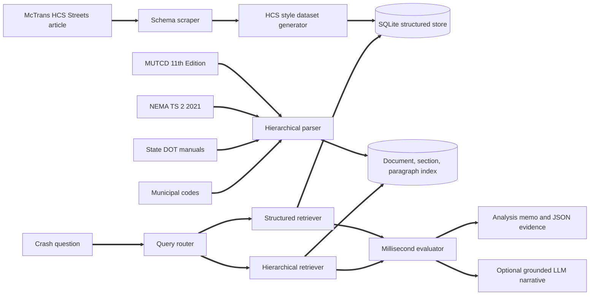

# Multi Jurisdictional Traffic Light Incident Legal Assistant AI

<p align="center">

</p>
source: https://www.magnific.com/free-photos-vectors/red-traffic-light


A hybrid structured and unstructured retrieval augmented generation (RAG) system that joins crash telemetry and millisecond controller logs with a hierarchical index of federal, state, local and hardware authority, then evaluates whether the yellow change and red clearance intervals met every governing requirement at the exact millisecond a vehicle crossed the stop line.

## Project Brief

When a multivehicle crash happens inside a signalized intersection, the first question every party asks is deceptively simple: what was the signal showing, and was it timed correctly? Answering it properly is anything but simple. A traffic engineer or legal analyst has to reconcile at least four bodies of authority that were never written to be read together. The federal Manual on Uniform Traffic Control Devices (MUTCD) sets the national floor. A state Department of Transportation manual usually fixes the kinematic method, the speed basis and its own minimums. A municipal code may add stricter local minimums, speed adjustments and maintenance deadlines. Finally, hardware standards such as NEMA TS 2 define how the controller and its malfunction management unit (MMU) are supposed to behave when timing goes wrong.

Those documents then have to be laid against raw evidence: high resolution controller event logs, detector fault histories, MMU logs, programmed timing plans and the speed and position of the vehicle from an event data recorder, video analytics or connected vehicle data. In practice this cross referencing is done by hand, spreadsheet by spreadsheet and PDF by PDF, and a single contested crash can consume hundreds of analyst hours. The work is also fragile. It is easy to apply the wrong state's policy to a city signal, to overlook a local ordinance that is stricter than the state manual, or to compare the programmed yellow with the requirement while missing that the controller actually displayed something different in the crash cycle.

This project automates that reconciliation. It treats the problem as hybrid retrieval: structured questions (which interval was each phase displaying at 07:36:36.755, and was it the same in every other cycle of the plan?) are answered by SQL over the controller database, while normative questions (which provision creates the duty, and is it a mandatory Standard or advisory Guidance?) are answered by hierarchical retrieval over the manuals, restricted to the jurisdiction that owns the intersection. An evaluation engine combines both into a structured finding set and an analysis memorandum in which every conclusion carries its measured value, its required value and a citation down to section, paragraph, provision type and printed page.

The data foundation follows the HCS Streets CSV export described by the McTrans Center article "Integrating HCS Signal Analyses with Excel for Efficient Traffic Studies" (mctrans.ce.ufl.edu, encoded link: [McTrans article](https://mctrans.ce.ufl.edu/integrate%2Dhcs%2Dsignal%2Danalyses%2Dwith%2Dexcel%2Dfor%2Defficient%2Dtraffic%2Dstudies/)). That article does not publish a downloadable table; it documents which parameters the export contains (intersection geometry, traffic, signal controller settings and performance measures) and how analysts build 2023, 2030 and 2035 scenarios from it. The project scrapes that parameter schema, maps each parameter to dataset columns, and generates a 16,320 row by 52 column HCS style dataset plus the incident telemetry that sits on top of it.

## What the Assistant Answers

<table>
<tr><th>Question type</th><th>Example</th><th>Route</th><th>Sources used</th></tr>
<tr><td>Crash liability analysis</td><td>Did the yellow interval meet requirements in crash CR00004?</td><td>HYBRID_CRASH</td><td>Controller log, telemetry, timing plan, detector and MMU logs, MUTCD, state manual, municipal code, NEMA TS 2</td></tr>
<tr><td>Signal state at a moment</td><td>What was INT0105 showing at 2025/09/18 07:36:36.755?</td><td>STRUCTURED_STATE</td><td>Controller log plus MUTCD indication meanings</td></tr>
<tr><td>Intersection profile</td><td>Show INT0012</td><td>INTERSECTION_PROFILE</td><td>HCS style timing table and crash history</td></tr>
<tr><td>Regulatory research</td><td>What is the minimum yellow change interval in the City of Northgate?</td><td>REGULATORY</td><td>Hierarchical retrieval, filtered to that city and its state</td></tr>
</table>

## Architecture



The unique capability is the join at the evaluator. It locates the interval every phase was displaying at the stop line entry millisecond, reconstructs where the vehicle was when yellow began, computes the governing requirement layer by layer, and then attaches the provisions that create each duty.

## Data

### Source and construction

The scraper (`trafficlegal/scraper.py`) downloads the McTrans article, extracts each bolded parameter group and its comma separated parameters, and maps all 21 scraped parameters to dataset columns. The mapping is saved to `data/raw/source_schema.json`. When the network is unavailable, a snapshot verified against the live article on 2026/09/30 is used so the pipeline stays reproducible.

Because the article supplies a schema rather than rows, the records themselves are synthetic. The generator (`trafficlegal/synth.py`) builds 170 intersections with dual ring, eight phase NEMA operation, assigns each to a jurisdiction, programs clearance intervals under one of three timing practices, allocates splits from HCM flow ratios for four timing plans, and computes HCM performance measures for the three scenario years named in the article. Crash windows are then simulated at millisecond resolution around the 2023 timing plans, with injected controller deviations, detector faults and MMU responses. Every crash carries a hidden ground truth label that the evaluator never reads, which makes objective benchmarking possible.

The two states (Avalon and Kestrel) and six municipalities are fictional. Their policy documents in `knowledge/state` and `knowledge/local` are generated from the same parameters the evaluator applies and carry a prominent synthetic notice. This allows the federal, state and local precedence logic to be exercised end to end without misrepresenting the law of any real place.

### Tables

<table>
<tr><th>Table</th><th>Rows</th><th>Columns</th><th>Grain and purpose</th></tr>
<tr><td>hcs_streets_export</td><td>16,320</td><td>52</td><td>Lane group by analysis period by scenario year (2023, 2030, 2035). Geometry, traffic, controller settings, HCM performance and clearance compliance.</td></tr>
<tr><td>signal_event_log</td><td>99,840</td><td>20</td><td>One row per phase interval (green, yellow, red clearance) over eight cycles around each crash, with epoch milliseconds, Indiana high resolution event codes, displayed and programmed durations.</td></tr>
<tr><td>crash_events</td><td>520</td><td>26</td><td>Impact and stop line entry times, subject and conflicting phase, telemetry reference point (speed and distance), conditions and the hidden benchmark label.</td></tr>
<tr><td>detector_faults</td><td>1,472</td><td>16</td><td>Open loop, shorted loop, excessive inductance change and watchdog failures with start, detection and clearance times.</td></tr>
<tr><td>mmu_events</td><td>394</td><td>10</td><td>Minimum yellow change faults, conflicts, red fail, Port 1 timeouts and voltage monitor trips.</td></tr>
<tr><td>signal_timing_plans</td><td>5,440</td><td>12</td><td>Cycle, offset, split, green, clearance, minimum green and passage time per plan and phase.</td></tr>
<tr><td>lane_group_geometry</td><td>1,360</td><td>18</td><td>Static per phase geometry, speeds and programmed clearances.</td></tr>
<tr><td>intersections</td><td>170</td><td>14</td><td>Inventory: jurisdiction, control type, controller standard, timing practice, area type.</td></tr>
<tr><td>jurisdiction_policy</td><td>6</td><td>20</td><td>State and local policy parameters that drive the governing requirement.</td></tr>
</table>

An Excel workbook (`data/processed/hcs_streets_export.xlsx`) mirrors the McTrans workflow with the full export, a scenario summary sheet and a clearance deficit sheet.

<p align="center"></p>

**Figure 1. Structured store volumes.** Rows per table on a logarithmic scale, with the column count and the grain of each table alongside.

The nine tables hold 125,522 rows in total and span more than four orders of magnitude, which is why Figure 1 uses a logarithmic axis: on a linear axis everything below the event log would collapse onto the baseline. The millisecond event log alone accounts for 79.5 percent of all rows (99,840 of 125,522) and close to two million cells (99,840 rows by 20 columns), while the widest table, the HCS style export, carries 848,640 cells across its 52 columns. The shape is deliberate. Evidence that must be resolved to the millisecond is stored at the finest grain, and everything that describes a place, a plan or a policy is stored once and joined in.

The row counts are not independent figures. Each one reconciles exactly with the generator design, which gives a quick integrity check on any regenerated dataset:

<table>
<tr><th>Quantity</th><th>Arithmetic</th><th>Result</th></tr>
<tr><td>Lane groups</td><td>170 intersections by 8 NEMA phases</td><td>1,360 rows in lane_group_geometry</td></tr>
<tr><td>Timing plan rows</td><td>1,360 lane groups by 4 timing plans</td><td>5,440 rows in signal_timing_plans</td></tr>
<tr><td>Export rows</td><td>1,360 lane groups by 4 analysis periods by 3 scenario years</td><td>16,320 rows in hcs_streets_export</td></tr>
<tr><td>Event log rows</td><td>520 crashes by 8 logged cycles by 8 phases by 3 interval types</td><td>99,840 rows in signal_event_log, or 192 interval rows per crash</td></tr>
</table>

Three ratios describe how densely the incident layer sits on the inventory. The 520 benchmark crashes average 3.1 per intersection, the 1,472 detector fault episodes average 8.7 per intersection, and the 394 MMU events amount to about 0.76 per crash window. At the other extreme, the 6 row jurisdiction_policy table is the smallest object in the store and the one with the most leverage: every governing requirement, and therefore every verdict, is computed from its 20 parameters. An error in a single policy row would propagate to every crash in that jurisdiction, which is why the synthetic policy documents are generated from the same parameters the evaluator applies.

The figures in this README are drawn by `docs/make_figures.py` from the results reported in the tables and findings of this document. The script holds those values as constants, so update them and rerun it whenever the data is regenerated with a different seed.

### Main table columns

<table>
<tr><th>Group (from the article)</th><th>Columns</th></tr>
<tr><td>Identification</td><td>scenario_year, analysis_period, timing_plan_id, state_code, jurisdiction_code, jurisdiction_name, intersection_id, intersection_name, corridor, area_type, control_type, controller_standard, timing_practice, nema_phase, ring, barrier, movement, approach, lane_group_kind</td></tr>
<tr><td>Intersection geometry</td><td>num_lanes, lane_width_ft, storage_length_ft, grade_pct, grade_direction, intersection_width_ft</td></tr>
<tr><td>Traffic</td><td>posted_speed_mph, speed_85th_mph, clearance_speed_mph, demand_vph, heavy_vehicle_pct, bicycles_vph, buses_per_hr, peak_hour_factor</td></tr>
<tr><td>Signal controller settings</td><td>cycle_length_s, offset_s, split_s, green_s, yellow_s, red_clearance_s, min_green_s, passage_time_s</td></tr>
<tr><td>Performance measures</td><td>saturation_flow_vph, capacity_vph, vc_ratio, control_delay_s, los, back_of_queue_ft, queue_storage_ratio</td></tr>
<tr><td>Clearance compliance</td><td>required_yellow_s, required_red_clearance_s, yellow_shortfall_s, red_clearance_shortfall_s</td></tr>
</table>

Grades are stored as a magnitude plus an uphill, downhill or level label, and shortfalls as non negative values, so every numeric column is non negative and every file stays free of dash characters.

## Key Findings

**Timing practice, not geography, is the dominant driver of clearance deficiencies.** Across the 1,360 lane groups in the 2023 timing plans, intersections timed with the full kinematic method under the governing policy show no yellow shortfall at all. Intersections timed to the posted speed only, ignoring an 85th percentile speed basis or a local speed adjustment, fall short on 72.8 percent of lane groups by an average of 0.38 s. Legacy flat timings (3.5 s through, 3.0 s left, 1.0 s red clearance) fall short on 82.2 percent of lane groups by an average of 0.79 s, and 77.6 percent of those lane groups also carry too little red clearance.

<p align="center"></p>

**Figure 2. Clearance deficiency by timing practice.** Share of lane groups with a yellow shortfall, the average size of that shortfall, and the share with a red clearance shortfall, for the 1,360 lane groups in the 2023 timing plans.

<table>
<tr><th>Timing practice</th><th>What the practice does</th><th>Lane groups with a yellow shortfall</th><th>Average yellow shortfall</th><th>Lane groups with a red clearance shortfall</th></tr>
<tr><td>Full kinematic method</td><td>Applies the governing policy in full</td><td>0.0 percent</td><td>None</td><td>Not reported</td></tr>
<tr><td>Posted speed only</td><td>Times to the posted speed and ignores an 85th percentile speed basis or a local speed adjustment</td><td>72.8 percent</td><td>0.38 s</td><td>Not reported</td></tr>
<tr><td>Legacy flat timings</td><td>3.5 s through, 3.0 s left and 1.0 s red clearance on every approach</td><td>82.2 percent</td><td>0.79 s</td><td>77.6 percent</td></tr>
</table>

Figure 2 separates two things that a single compliance rate would blur: how often a practice falls short, and by how much. The two deficient practices are close on frequency (72.8 against 82.2 percent, a gap of 9.4 points) but far apart on severity, with the legacy flat shortfall averaging 0.79 s, which is 2.1 times the 0.38 s of the posted speed practice. Frequency shows where to look; severity shows where the exposure is.

The zero in the first row is an internal control as much as a finding. Intersections timed with the full kinematic method are programmed from the same policy parameters that the evaluator later applies, so any shortfall reported for them would point to a defect in the requirement logic and not in the timing. A clean control group is what allows the other two rows to be read as real deficiencies.

The posted speed shortfall has a direct physical reading. In the ITE equation, with the 1.0 s reaction time and 10 ft/s^2 deceleration that reproduce the worked example later in this document, each additional mile per hour of clearance speed adds about 0.073 s of yellow on a level approach. An average shortfall of 0.38 s therefore corresponds to a speed basis that is about 5 mph too low. That is the ordinary distance between a posted limit and a measured 85th percentile speed, and it matches crash CR00004, where the 5.4 mph gap between the posted 35.0 mph and the measured 40.4 mph accounts for 0.40 s of yellow.

Legacy flat timings fail for a structural reason: a constant cannot follow a requirement that rises with speed. Under the same parameters, a flat 3.5 s through yellow satisfies the kinematic equation only up to 34.1 mph on a level approach, and a flat 3.0 s left turn yellow only up to 27.3 mph, the speed at which the kinematic value meets the MUTCD floor. Every faster approach is deficient by construction. An average shortfall of 0.79 s is equivalent to a speed basis almost 11 mph too low, or about 46 ft of travel at 40 mph. The red clearance column tells the same story for the flat 1.0 s value, which falls short on 77.6 percent of legacy lane groups. Taken together, the two shares imply that at least 59.8 percent of legacy lane groups are deficient on both intervals at once (82.2 plus 77.6 minus 100), so the exposure is compounded on the same approaches and not merely spread across different ones.

Hardware monitoring does not catch this class of deficiency. Both legacy yellow values sit above the 2.7 s MMU minimum yellow threshold, by 0.8 s and 0.3 s, so the malfunction management unit sees a healthy controller while the policy requirement is being missed. Only a comparison against the governing requirement, layer by layer, exposes it.

For a retiming programme the ranking follows directly. Legacy flat intersections come first, because the shortfall is twice as large and usually affects both intervals. Posted speed intersections come second, and can often be corrected by adopting the speed basis that the governing policy already specifies.

**Jurisdiction changes the answer for identical hardware.** The same programmed yellow can be compliant in one city and deficient in the next. Kestrel requires timing to the measured 85th percentile speed, and 35.8 percent of its lane groups show a yellow shortfall against 25.6 percent in Avalon, which times to the posted limit. Local layers matter as well: Stonebridge requires 1.2 s of red clearance, so a 1.0 s red clearance that satisfies the Kestrel state minimum still fails locally. This is exactly the class of error that manual cross referencing tends to miss.

<p align="center"></p>

**Figure 3. Jurisdiction effects on the governing requirement.** Left: share of lane groups with a yellow shortfall by state. Right: the red clearance layers that apply in the City of Stonebridge, State of Kestrel.

<table>
<tr><th>Red clearance layer in Stonebridge</th><th>Value</th><th>Outcome for a programmed 1.0 s</th></tr>
<tr><td>Programmed red clearance</td><td>1.0 s</td><td>Value under review</td></tr>
<tr><td>Kestrel state minimum</td><td>1.0 s</td><td>Satisfied, with no margin</td></tr>
<tr><td>Stonebridge local minimum</td><td>1.2 s</td><td>Not satisfied, 0.2 s short; this layer governs</td></tr>
</table>

The left panel of Figure 3 shows the state effect. Kestrel lane groups fall short 35.8 percent of the time against 25.6 percent in Avalon, a difference of 10.2 points, or 1.4 times the Avalon rate. The mechanism is the speed basis: a measured 85th percentile speed normally sits above the posted limit, so the same programmed yellow is tested against a higher clearance speed in Kestrel and fails more often.

That comparison should be read with one caution. The shares are reported without the number of lane groups or the mix of timing practices in each state, so the 10.2 point difference combines the policy effect with any difference in that mix. Isolating the policy effect needs a breakdown by state and practice together, which a single query against the structured store provides:

```bash
python run.py sql "SELECT state_code, timing_practice, COUNT(*) AS lane_group_rows, ROUND(100.0 * AVG(yellow_shortfall_s > 0), 1) AS pct_short FROM hcs_streets_export WHERE scenario_year = 2023 GROUP BY state_code, timing_practice"
```

The right panel shows the local effect. A 1.0 s red clearance meets the Kestrel state minimum exactly and misses the Stonebridge minimum of 1.2 s by 0.2 s, so the programmed value is 83 percent of what governs. A review that stopped at the federal and state layers would have recorded the interval as compliant. At the 41.5 mph recorded in crash CR00004, 0.2 s is about 12 ft of travel, roughly one lane width of additional protection for a vehicle still clearing the intersection.

Both panels illustrate the same rule from different directions: compliance is a property of the intersection and of the authority that owns it, not of the controller settings alone. The evaluator therefore never tests a programmed value against a single number. It computes each layer separately, takes the strictest, and names every layer that governs, so the memo shows not only that an interval failed but which body of authority made it fail.

**Future demand erodes performance under existing timings.** Holding 2023 plans constant, the share of lane groups at LOS F rises from 12.2 percent in 2023 to 21.2 percent in 2030 and 28.5 percent in 2035. Mean control delay climbs from 53.0 s to 61.0 s to 69.9 s, and the share of lane groups whose back of queue exceeds available storage roughly doubles from 11.2 percent to 23.6 percent. This reproduces the scenario analysis the McTrans article describes and flags where retiming studies should begin.

<p align="center"></p>

**Figure 4. Performance erosion under constant 2023 timing plans.** Share of lane groups at LOS F, mean control delay with the HCM signalized LOS thresholds, and share of lane groups whose back of queue exceeds storage.

<table>
<tr><th>Measure</th><th>2023</th><th>2030</th><th>2035</th><th>Change from 2023 to 2035</th></tr>
<tr><td>Lane groups at LOS F</td><td>12.2 percent</td><td>21.2 percent</td><td>28.5 percent</td><td>Up 16.3 points, 2.3 times the 2023 share</td></tr>
<tr><td>Mean control delay</td><td>53.0 s</td><td>61.0 s</td><td>69.9 s</td><td>Up 16.9 s, or 31.9 percent</td></tr>
<tr><td>Back of queue beyond storage</td><td>11.2 percent</td><td>Not reported</td><td>23.6 percent</td><td>Up 12.4 points, 2.1 times the 2023 share</td></tr>
</table>

The deterioration is not linear. The LOS F share rises by 9.0 points over the seven years to 2030 and by 7.3 points over the five years to 2035, which is 1.3 points per year followed by 1.5. Mean control delay rises by 8.0 s and then by 8.9 s, or 1.1 s per year followed by 1.8 s per year. The acceleration is what the HCM delay model predicts: once the volume to capacity ratio of a lane group approaches 1.0, the incremental delay term grows much faster than demand, so each additional increment of traffic costs more delay than the one before.

The mean also understates the problem. A mean control delay of 53.0 s sits just inside the LOS D band, since the HCM signalized thresholds place LOS E above 55 s and LOS F above 80 s, and by 2030 the mean has crossed into LOS E. Yet even in 2035, when the mean of 69.9 s is still below the LOS F threshold, 28.5 percent of lane groups are individually at LOS F. The distribution is dispersed, with a substantial failing tail behind an average that still reads as LOS E, which is why the shares are reported alongside the mean.

Queue spillback follows the same path. The share of lane groups whose back of queue exceeds the available storage rises from 11.2 to 23.6 percent, slightly more than double. Spillback matters beyond delay, because a queue that overflows its storage blocks the adjacent lane or the upstream intersection, so the lane groups in this category are where capacity problems begin to turn into operational and safety problems.

Two practical points follow. First, clearance compliance does not move with the scenario year: the governing yellow and red clearance depend on speed, grade and policy, not on demand, so the deficiencies in Figure 2 persist unchanged through 2035 unless the plans are retimed. Second, the retiming studies that the capacity results call for are the natural occasion to correct the clearance intervals as well, and the clearance deficit sheet in the Excel workbook identifies which intersections should lead that programme.

**The evaluator separates driver behaviour from signal deficiency.** Of 520 benchmark crashes, the evaluator classifies 99.4 percent correctly. Every one of the three misclassifications was flagged as moderate confidence by the speed uncertainty test, while the 82.7 percent of verdicts issued with high confidence were correct in every case. For legal use this calibration is more valuable than the headline accuracy: it tells the analyst exactly which findings need an expert's second look.

Figures 7 and 8 in the Benchmarks section show this result in detail. In operational terms, an expert who reviews only the 90 moderate confidence verdicts, which is 17.3 percent of the caseload, sees every one of the three errors, while the 430 high confidence verdicts contain none. All three errors also run in the same direction: each is a true yellow timing deficiency that was read as a red entry with no signal deficiency, so the evaluator never attributed a deficiency to a correctly timed signal on this benchmark.

## Hierarchical Retrieval

Documents are parsed into a three level tree by `trafficlegal/ingest.py`:

<table>
<tr><th>Level</th><th>Unit</th><th>Example</th></tr>
<tr><td>1. Document</td><td>Tier (FEDERAL, STATE, LOCAL, HARDWARE) and jurisdiction</td><td>MUTCD 11th Edition, FEDERAL</td></tr>
<tr><td>2. Section</td><td>MUTCD section, policy clause or NEMA clause with chapter and printed page</td><td>Section 4F.17 Yellow Change and Red Clearance Intervals, page 708</td></tr>
<tr><td>3. Paragraph</td><td>Numbered paragraph tagged Standard, Guidance, Option, Support, Clause or Specification</td><td>Paragraph 08, Standard: the yellow change interval shall not vary cycle by cycle within a timing plan</td></tr>
</table>

The MUTCD parses into 954 sections and 6,388 paragraphs. Provision types carry legal weight: a Standard uses "shall" and is mandatory, Guidance uses "should", an Option uses "may" and Support is informational. Page citations are resolved per page so the pdftotext and pypdf extraction paths produce identical citations.

Retrieval (`trafficlegal/retriever.py`) runs in three stages:

1. **Routing.** The corpus is restricted to the requested tiers and to the state and municipality that own the intersection. A Kestrel crash is never argued with Avalon policy, and a test enforces this.
2. **Section ranking.** BM25 over section headings (weighted three times) and bodies, run separately inside each tier, with min max normalisation of section scores. Explicit section references in a query, such as 4F.17, are pinned.
3. **Paragraph ranking.** BM25 over paragraphs inside the winning sections only, multiplied by a provision weight (Standard 1.25, Guidance 1.12, Support 0.92) and blended with the parent section score. Results are diversified so each tier contributes evidence.

The lexical layer includes a light plural stemmer and a traffic engineering thesaurus (amber to yellow, all red to red clearance, loop to detector, MMU to malfunction management unit). It needs no model downloads and runs offline.

Each of the three stages answers a specific failure mode of flat retrieval over legal text. The MUTCD averages 6.7 paragraphs per section (6,388 across 954), and a single section commonly mixes mandatory Standards with advisory Guidance and informational Support, so ranking paragraphs without first fixing the section tends to return fragments stripped of the heading that gives them meaning. Ranking sections first and paragraphs second keeps every cited paragraph attached to its section, chapter and printed page. Running BM25 separately inside each tier and normalising the scores keeps a long federal manual from crowding out a short municipal code purely on term statistics, which matters because the shortest document is often the one that governs. The provision weights then encode legal force directly in the ranking: at equal lexical relevance a Standard scores 1.36 times a Support paragraph (1.25 against 0.92) and 1.12 times a Guidance paragraph (1.25 against 1.12), so a mandatory duty surfaces ahead of commentary about it without suppressing that commentary altogether. Retrieval quality on the analyst question set is reported with Figure 8 in the Benchmarks section.

## The Millisecond Evaluation

`trafficlegal/evaluator.py` reconstructs the event from the telemetry reference point under a constant speed assumption, checks that reconstruction against the recorded stop line entry, and then runs these checks:

<table>
<tr><th>Check</th><th>What is tested</th><th>Primary authority</th></tr>
<tr><td>INDICATION_AT_ENTRY</td><td>Interval displayed by the subject phase at the entry millisecond</td><td>Controller log</td></tr>
<tr><td>MUTCD_YELLOW_RANGE</td><td>Programmed yellow between 3 and 6 s</td><td>MUTCD 4F.17 Paragraph 13 (Guidance)</td></tr>
<tr><td>YELLOW_CONSISTENCY</td><td>Displayed yellow equals programmed yellow in every logged cycle of the plan</td><td>MUTCD 4F.17 Paragraphs 07 and 08 (Standard), state Clause 3.4</td></tr>
<tr><td>RED_CLEARANCE_CONSISTENCY</td><td>Red clearance not decreased or omitted in the crash cycle</td><td>MUTCD 4F.17 Paragraph 09 (Standard)</td></tr>
<tr><td>YELLOW_REQUIREMENT</td><td>Programmed yellow against the strictest of the federal, state kinematic, state minimum and local layers</td><td>MUTCD 4F.17 Paragraph 03, state Clause 3.2, local Sections 1.02, 1.04, 1.05</td></tr>
<tr><td>RED_CLEARANCE_REQUIREMENT and MAXIMUM</td><td>Programmed red clearance against the governing minimum and the 6 s guidance</td><td>MUTCD 4F.17 Paragraphs 06 and 13, state Clause 3.3, local Section 1.03</td></tr>
<tr><td>DILEMMA_ZONE</td><td>Type I dilemma zone: the vehicle could not stop comfortably and did not reach the stop line before red</td><td>ITE kinematics, MUTCD 4F.17 Paragraph 01</td></tr>
<tr><td>INDECISION_ZONE</td><td>Type II zone: 2.5 to 5.5 s of travel from the stop line at yellow onset</td><td>Engineering practice</td></tr>
<tr><td>MMU_RESPONSE</td><td>If the displayed yellow fell below the MMU threshold, did the MMU trip?</td><td>NEMA TS 2 4.4.5 and 2.3.8, state Clause 3.5</td></tr>
<tr><td>DETECTOR_STATUS</td><td>Active detector faults on the subject phase and whether the local repair window was exceeded</td><td>State Clause 3.6, local Section 1.06, MUTCD 4A.10</td></tr>
<tr><td>CONFLICTING_RELEASE and TELEMETRY_CONSISTENCY</td><td>Time from subject red to conflicting green; agreement between telemetry and the recorded entry</td><td>Controller log and telemetry</td></tr>
</table>

The governing yellow is `max(3.0 s MUTCD floor, ITE kinematic value, state minimum, local minimum, local high speed minimum)`, capped at the 6 s MUTCD guidance, where the ITE value is `t + v / (2a + 2Gg)` with the state's reaction time, deceleration and speed basis plus any local speed adjustment. When layers tie, the memo names every layer that governs.

<p align="center"></p>

**Figure 5. Governing yellow change interval by clearance speed.** The ITE kinematic value on a level approach, with a band for 3 percent downhill and uphill grades, bounded by the MUTCD 3 s floor and 6 s guidance. Crash CR00004 is marked at its posted and 85th percentile speeds.

Figure 5 plots the requirement that the YELLOW_REQUIREMENT check applies. In the kinematic term, t is the perception and reaction time, v the clearance speed in feet per second, a the deceleration rate, G the approach grade as a decimal (taken as positive uphill and negative downhill, with the sign applied from the stored direction label) and g the gravitational acceleration of 32.2 ft/s^2. The figure uses a reaction time of 1.0 s and a deceleration of 10 ft/s^2, the values that reproduce the 3.96 s requirement in the CR00004 memorandum (1.0 s plus 59.25 ft/s divided by 20 ft/s^2). Each jurisdiction supplies its own reaction time, deceleration and speed basis through `jurisdiction_policy`, so the curve shifts with the policy while its shape stays the same.

<table>
<tr><th>Clearance speed</th><th>Level approach</th><th>3 percent downhill</th><th>3 percent uphill</th></tr>
<tr><td>25 mph</td><td>3.00 s (MUTCD floor governs; kinematic value 2.83 s)</td><td>3.03 s</td><td>3.00 s (MUTCD floor governs)</td></tr>
<tr><td>30 mph</td><td>3.20 s</td><td>3.44 s</td><td>3.01 s</td></tr>
<tr><td>35 mph</td><td>3.57 s</td><td>3.84 s</td><td>3.34 s</td></tr>
<tr><td>40 mph</td><td>3.93 s</td><td>4.25 s</td><td>3.67 s</td></tr>
<tr><td>45 mph</td><td>4.30 s</td><td>4.65 s</td><td>4.01 s</td></tr>
<tr><td>50 mph</td><td>4.67 s</td><td>5.06 s</td><td>4.34 s</td></tr>
<tr><td>55 mph</td><td>5.03 s</td><td>5.46 s</td><td>4.68 s</td></tr>
<tr><td>60 mph</td><td>5.40 s</td><td>5.87 s</td><td>5.01 s</td></tr>
</table>

Four readings of the figure matter in practice:

* **Sensitivity to the speed basis.** On a level approach the requirement rises by 0.073 s for every mile per hour, so a 5 mph error in the speed basis moves the requirement by 0.37 s. This is the whole difference between a posted speed policy and an 85th percentile policy, and it is larger than the tolerance any timing review would accept.
* **Where the federal bounds bind.** The 3 s floor governs below 27.3 mph on a level approach (24.6 mph on a 3 percent downgrade, 29.9 mph on a 3 percent upgrade), and the 6 s guidance is not reached on a level approach until 68.2 mph. Across ordinary arterial speeds the kinematic layer, or a state or local minimum above it, is what governs, and the federal bounds act as guard rails.
* **Grade direction.** At 40.4 mph a 3 percent downgrade raises the requirement from 3.96 s to 4.28 s and a 3 percent upgrade lowers it to 3.70 s, a spread of 0.58 s from direction alone. This is why the dataset stores grade as a magnitude plus an explicit uphill, downhill or level label: a direction recorded the wrong way round would misstate the requirement by more than half a second.
* **Decomposing the CR00004 shortfall.** The approach would need 3.57 s at its posted 35.0 mph and needs 3.96 s at the 85th percentile speed of 40.4 mph that Kestrel policy specifies. Against the programmed 3.5 s, 0.396 s of the shortfall comes from the speed basis and the remaining 0.067 s from the flat programmed value, 0.463 s in total, which the memo reports as 0.46 s. The programmed interval would have been marginally short even on a posted speed basis, and is materially short on the governing one.

Verdicts are assigned in priority order: CONTROLLER_TIMING_DEVIATION, YELLOW_TIMING_BELOW_REQUIREMENT, DETECTION_SYSTEM_FAULT, NO_SIGNAL_DEFICIENCY_RED_ENTRY and NO_SIGNAL_DEFICIENCY_LAWFUL_ENTRY. Confidence drops to moderate when the telemetry disagrees with the recorded entry by more than 150 ms, or when the stopping conclusion flips within a 1 mph speed uncertainty.

### Example memo excerpt

```text
# Signal Timing Incident Analysis: CR00004

Verdict: Yellow Timing Below Requirement
Programmed yellow change interval was below the governing requirement and the
vehicle was trapped in a dilemma zone. Confidence: High.

* Location: Meridian Road and Walnut Street (INT0105), City of Stonebridge, State of Kestrel.
* Yellow onset 2025/09/18 07:36:33.013, red onset 2025/09/18 07:36:36.513,
  stop line entry 2025/09/18 07:36:36.755, impact 2025/09/18 07:36:37.670.
* Indication at entry: RED_CLEARANCE (0.242 s after red onset).
* Vehicle: 41.5 mph, 234.4 ft from the stop line at yellow onset.
* Approach: posted 35.0 mph, 85th percentile 40.4 mph.

Governing yellow: 3.96 s from state kinematic, clearance speed 40.4 mph (programmed 3.5 s).
Governing red clearance: 1.2 s from local minimum (programmed 1.0 s).
```

Each finding in the full memo is followed by quoted authority, for example MUTCD 11th Edition, Section 4F.17, Paragraph 03, Standard, page 708, then the Kestrel directive Clause 3.2 and the Stonebridge code Section 1.02. Each run writes two files to `artifacts/reports`: `CRxxxxx.md`, the readable memo, and `CRxxxxx.json`, which keeps every fact, check and evidence paragraph verbatim for preservation and expert review. The memo renders dash characters in quoted excerpts as spaces to keep the output dash free; set `TRAFFICLEGAL_VERBATIM_MEMO=1` to quote manuals exactly.

<p align="center"></p>

**Figure 6. Crash CR00004 reconstructed in time and distance.** Upper panel: the displayed and governing clearance sequences against the recorded entry and impact times. Lower panel: the stopping, dilemma and clearing zones for a vehicle at 41.5 mph, with the vehicle position at yellow onset.

<table>
<tr><th>Event</th><th>Clock time on 2025/09/18</th><th>After yellow onset</th><th>Basis</th></tr>
<tr><td>Yellow onset</td><td>07:36:33.013</td><td>0.000 s</td><td>Controller log</td></tr>
<tr><td>Red onset, end of the programmed 3.5 s yellow</td><td>07:36:36.513</td><td>3.500 s</td><td>Controller log</td></tr>
<tr><td>Stop line entry</td><td>07:36:36.755</td><td>3.742 s</td><td>Recorded entry</td></tr>
<tr><td>End of the governing 3.96 s yellow</td><td>07:36:36.973</td><td>3.960 s</td><td>Computed from the memo</td></tr>
<tr><td>End of the programmed 1.0 s red clearance</td><td>07:36:37.513</td><td>4.500 s</td><td>Computed from the memo</td></tr>
<tr><td>Impact</td><td>07:36:37.670</td><td>4.657 s</td><td>Crash record</td></tr>
<tr><td>End of the governing 3.96 s yellow and 1.2 s red clearance</td><td>07:36:38.173</td><td>5.160 s</td><td>Computed from the memo</td></tr>
</table>

The upper panel of Figure 6 places the recorded events against two versions of the clearance sequence: the one the controller displayed and the one the governing layers required. The vehicle crossed the stop line 3.742 s after yellow onset, which is 0.242 s into red clearance. Had the yellow run for the governing 3.96 s, the same crossing would have fallen 0.218 s before the end of yellow. The crossing that the log records as a red entry would have been a lawful entry under the required timing, and that is the distinction the evaluator draws between YELLOW_TIMING_BELOW_REQUIREMENT and NO_SIGNAL_DEFICIENCY_RED_ENTRY.

The red clearance layer compounds the picture. Impact came 0.915 s after entry and 0.157 s after the programmed 1.0 s red clearance had expired, the point from which a conflicting phase can be released. Under the governing intervals the all red period would have lasted until 5.160 s, which is 0.503 s beyond the moment of impact. This is a comparison of timelines and not a finding of causation. The CONFLICTING_RELEASE check reports the measured time from subject red to conflicting green from the controller log, and causation remains a question for the expert and the court.

The lower panel explains why the driver was exposed. At 41.5 mph (60.87 ft/s), with a 1.0 s reaction time and a 10 ft/s^2 deceleration, a comfortable stop needs 246.1 ft: 60.9 ft of reaction travel plus 185.2 ft of braking. In a 3.5 s yellow the same vehicle covers 213.0 ft. A vehicle between 213.0 and 246.1 ft from the stop line at yellow onset can neither stop comfortably nor reach the line before red, and that 33.1 ft band is the Type I dilemma zone. The vehicle was at 234.4 ft, which is 11.7 ft too close to stop and 21.4 ft too far to clear. With the governing 3.96 s yellow the reach distance extends to 241.0 ft, the vehicle clears with 6.6 ft in hand, and the zone shrinks to 5.1 ft, a residue that exists only because the vehicle was travelling 1.1 mph above the 40.4 mph speed basis.

Two further checks support the High confidence rating. The telemetry is self consistent: 234.4 ft at a constant 41.5 mph takes 3.851 s, against a recorded entry at 3.742 s, a difference of 109 ms and inside the 150 ms tolerance. The conclusion is also stable under speed uncertainty. At 40.5 mph and at 42.5 mph the vehicle remains inside the dilemma zone of the programmed yellow (207.9 to 235.8 ft and 218.2 to 256.6 ft respectively) and outside it under the governing yellow, so a 1 mph error in the telemetry does not flip the finding.

These distances are worked from the memo values with the parameters stated above. The DILEMMA_ZONE check applies the same kinematics inside the evaluator, using the reaction time and deceleration of the governing jurisdiction, and the JSON evidence file preserves every input so that an expert can repeat the arithmetic.

## Benchmarks

Run `python run.py benchmark`. Results on the shipped data (seed 20260930):

<table>
<tr><th>Verdict</th><th>Support</th><th>Precision</th><th>Recall</th></tr>
<tr><td>CONTROLLER_TIMING_DEVIATION</td><td>98</td><td>1.000</td><td>1.000</td></tr>
<tr><td>DETECTION_SYSTEM_FAULT</td><td>72</td><td>1.000</td><td>1.000</td></tr>
<tr><td>NO_SIGNAL_DEFICIENCY_LAWFUL_ENTRY</td><td>82</td><td>1.000</td><td>1.000</td></tr>
<tr><td>NO_SIGNAL_DEFICIENCY_RED_ENTRY</td><td>194</td><td>0.985</td><td>1.000</td></tr>
<tr><td>YELLOW_TIMING_BELOW_REQUIREMENT</td><td>74</td><td>1.000</td><td>0.960</td></tr>
</table>

Overall accuracy is 0.994. Accuracy is 1.000 for high confidence verdicts (82.7 percent of cases) and 0.967 for moderate confidence verdicts. The labels come from the same generator the evaluator was designed around, so this benchmark verifies that the reasoning is internally correct and well calibrated; it is not evidence of field accuracy.

<p align="center"></p>

**Figure 7. Verdict benchmark.** Support per verdict, and precision and recall with 95 percent Wilson score intervals. The score axis starts at 0.85 so that the intervals are legible.

The support, precision and recall figures above determine the full confusion matrix, and they determine it uniquely:

<table>
<tr><th>True verdict (rows) against evaluator verdict (columns)</th><th>Controller timing deviation</th><th>Detection system fault</th><th>Lawful entry</th><th>Red entry</th><th>Yellow timing below requirement</th><th>Support</th></tr>
<tr><td>CONTROLLER_TIMING_DEVIATION</td><td>98</td><td>0</td><td>0</td><td>0</td><td>0</td><td>98</td></tr>
<tr><td>DETECTION_SYSTEM_FAULT</td><td>0</td><td>72</td><td>0</td><td>0</td><td>0</td><td>72</td></tr>
<tr><td>NO_SIGNAL_DEFICIENCY_LAWFUL_ENTRY</td><td>0</td><td>0</td><td>82</td><td>0</td><td>0</td><td>82</td></tr>
<tr><td>NO_SIGNAL_DEFICIENCY_RED_ENTRY</td><td>0</td><td>0</td><td>0</td><td>194</td><td>0</td><td>194</td></tr>
<tr><td>YELLOW_TIMING_BELOW_REQUIREMENT</td><td>0</td><td>0</td><td>0</td><td>3</td><td>71</td><td>74</td></tr>
<tr><td>Evaluator total</td><td>98</td><td>72</td><td>82</td><td>197</td><td>71</td><td>520</td></tr>
</table>

Three verdicts are wrong in total (520 minus 517). The only class with imperfect recall is YELLOW_TIMING_BELOW_REQUIREMENT, where 71 of 74 cases are recovered (0.9595, shown in the table as 0.960), and the only class with imperfect precision is NO_SIGNAL_DEFICIENCY_RED_ENTRY, where 194 of 197 predictions are correct (0.985). The three errors are therefore the same three crashes: true yellow timing deficiencies that the evaluator read as red entries with no signal deficiency.

The direction of that error is the most important fact in the benchmark for legal use. Every miss understates a signal deficiency, and none attributes a deficiency to a signal that was correctly timed. In a liability setting these two kinds of error carry very different costs, and an analyst needs to know which one the tool is capable of making. All three cases are marked moderate confidence by the speed uncertainty test, so the errors the evaluator does make are the ones it routes to an expert (Figure 8).

The whiskers in Figure 7 put the point estimates in proportion to the sample. Overall accuracy of 0.994 carries a 95 percent interval of 0.983 to 0.998. Yellow timing recall of 0.960 on 74 cases carries 0.887 to 0.986, the widest in the table, and red entry precision of 0.985 carries 0.956 to 0.995. Even a perfect score on 72 cases supports a lower bound of only 0.949, so the classes scored at 1.000 are best described as having no observed errors, not as error free.

Class balance does not flatter the result. The largest class, red entry with no signal deficiency, is 37.3 percent of the benchmark, so a trivial classifier that always returned it would score 0.373. Deficiency verdicts (controller deviation, yellow timing and detection fault) make up 244 of the 520 cases, or 46.9 percent, against 276 with no signal deficiency. Averaged over the five classes with equal weight, precision is 0.997, recall is 0.992 and the F1 score is 0.994, essentially the same as overall accuracy, which confirms that performance is not carried by the majority class.

Retrieval is scored on 16 analyst style questions with known target sections in the MUTCD and NEMA TS 2: hit rate at 1 is 0.75, hit rate at 3 is 0.875 and mean reciprocal rank is 0.84. The section blend weight was chosen on this same question set, so treat these figures as optimistic and extend `RETRIEVAL_CASES` in `trafficlegal/benchmark.py` with held out questions before relying on them.

<p align="center"></p>

**Figure 8. Confidence calibration and retrieval quality.** Verdicts issued and accuracy by confidence tier, and the three retrieval metrics on the 16 question set. Whiskers are 95 percent Wilson score intervals.

<table>
<tr><th>Confidence tier</th><th>Verdicts</th><th>Share of cases</th><th>Correct</th><th>Accuracy</th><th>95 percent Wilson interval</th></tr>
<tr><td>High</td><td>430</td><td>82.7 percent</td><td>430</td><td>1.000</td><td>0.991 to 1.000</td></tr>
<tr><td>Moderate</td><td>90</td><td>17.3 percent</td><td>87</td><td>0.967</td><td>0.907 to 0.989</td></tr>
<tr><td>All verdicts</td><td>520</td><td>100 percent</td><td>517</td><td>0.994</td><td>0.983 to 0.998</td></tr>
</table>

The first two panels of Figure 8 show why the confidence tier is the operationally important output. The evaluator issues 430 verdicts with high confidence and all 430 are correct; it issues 90 with moderate confidence and 87 are correct. The error rate is zero in one tier and 3.3 percent in the other, and the tier that needs review is the small one. An expert who examines only the moderate tier reads 17.3 percent of the caseload and sees every error in the benchmark, which is a workable division of labour for a process that can otherwise consume hundreds of analyst hours on a single contested crash. The interval on the high tier means the benchmark supports a high confidence accuracy of at least 0.991 at the 95 percent level; it is not a guarantee of perfection.

Both triggers for moderate confidence are physical: a telemetry reconstruction that disagrees with the recorded entry by more than 150 ms, or a stopping conclusion that flips within 1 mph of speed uncertainty. They flag cases that sit close to a decision boundary in the kinematics, which are the cases where a second opinion changes outcomes, and that is the reason to expect the tiering to remain meaningful on field data even though the accuracy figures themselves will not transfer.

<table>
<tr><th>Retrieval metric</th><th>Value</th><th>Questions</th><th>95 percent Wilson interval</th></tr>
<tr><td>Hit rate at 1</td><td>0.75</td><td>12 of 16</td><td>0.51 to 0.90</td></tr>
<tr><td>Hit rate at 3</td><td>0.875</td><td>14 of 16</td><td>0.64 to 0.97</td></tr>
<tr><td>Mean reciprocal rank</td><td>0.84</td><td>16</td><td>Not applicable</td></tr>
</table>

The third panel reports retrieval and should be read with its sample size in view. With 16 questions the Wilson intervals are wide, 0.51 to 0.90 for the hit rate at 1 and 0.64 to 0.97 for the hit rate at 3. The three metrics are nonetheless informative together. Twelve targets ranked first and two more ranked inside the top three. A mean reciprocal rank of 0.84 is then attainable only if both of those two ranked second, which alone gives 13 of 16 or 0.8125, and if the two remaining targets still ranked shortly below third. On that reading, which assumes conventional rounding of the reported 0.84, the two misses at rank three are near misses in which the right section was retrieved slightly too low, not failures to find it.

The practical weight of these figures differs by route. The crash memorandum takes its primary authority from the citations pinned in `evaluator.PINS`, so its core citations do not rest on BM25 ranking alone; the retrieval figures bear mainly on the free text REGULATORY route and on the supporting evidence gathered around the pinned provisions. Since the section blend weight was tuned on these same 16 questions, the intervals above should be treated as the optimistic end of what held out questions will show.

## Quick Start

Requires Python 3.10 or newer. Poppler's `pdftotext` is used when present for fast PDF extraction; otherwise pypdf is used automatically and the first index build takes a few minutes. The extracted text is then cached.

```bash
pip install .
python run.py setup
python run.py benchmark
python run.py evaluate CR00004
python run.py ask "What is the minimum yellow change interval in the City of Northgate?"
python run.py serve
pytest
```

`setup` runs the scrape, generate, excel, ingest and builddb steps in order. After installation the same commands are also available as `trafficlegal <command>`.

### Command reference

<table>
<tr><th>Command</th><th>Purpose</th><th>Options</th></tr>
<tr><td>setup</td><td>Full pipeline from scrape to database</td><td></td></tr>
<tr><td>scrape</td><td>Scrape the article schema</td><td></td></tr>
<tr><td>generate</td><td>Build every dataset and the policy documents</td><td>intersections=170 crashes=520 seed=20260930</td></tr>
<tr><td>excel</td><td>Write the HCS style workbook</td><td></td></tr>
<tr><td>ingest</td><td>Parse the knowledge base into the hierarchical index</td><td></td></tr>
<tr><td>builddb</td><td>Load the CSV tables into SQLite</td><td></td></tr>
<tr><td>crashes</td><td>List crashes</td><td>limit=20 intersection=INT0001</td></tr>
<tr><td>evaluate CRASH_ID</td><td>Millisecond evaluation and memo</td><td></td></tr>
<tr><td>ask "QUESTION"</td><td>Routed free text question</td><td></td></tr>
<tr><td>retrieve "QUERY"</td><td>Hierarchical retrieval only</td><td>state=KS jurisdiction=NGT k=8</td></tr>
<tr><td>sql "SELECT ..."</td><td>Read only SQL against the structured store</td><td>limit=200</td></tr>
<tr><td>benchmark</td><td>Verdict and retrieval benchmarks</td><td></td></tr>
<tr><td>serve</td><td>Start the HTTP API</td><td>host=127.0.0.1 port=8000</td></tr>
</table>

Options use the form `key=value` throughout.

### HTTP API

Interactive documentation is available at `/docs` once the server is running.

<table>
<tr><th>Method and path</th><th>Purpose</th></tr>
<tr><td>GET /health</td><td>Liveness and version</td></tr>
<tr><td>GET /crashes</td><td>List crashes, optionally filtered by intersection_id</td></tr>
<tr><td>GET /crashes/{crash_id}/evaluation</td><td>Full structured evaluation with evidence</td></tr>
<tr><td>GET /crashes/{crash_id}/memo</td><td>Markdown memorandum</td></tr>
<tr><td>POST /ask</td><td>Routed question: {"question": "...", "save_report": false}</td></tr>
<tr><td>GET /retrieve</td><td>Hierarchical retrieval with optional state_code and jurisdiction_code</td></tr>
<tr><td>POST /sql</td><td>Read only single SELECT statements with a row cap</td></tr>
</table>

### Docker

```bash
docker compose up
```

`compose.yaml` builds the image from the Dockerfile, which installs the package, runs the full setup pipeline during the build and serves the API on port 8000.

## Configuration

<table>
<tr><th>Variable</th><th>Default</th><th>Effect</th></tr>
<tr><td>TRAFFICLEGAL_DATA_DIR</td><td>data</td><td>Location of raw and processed tables</td></tr>
<tr><td>TRAFFICLEGAL_KNOWLEDGE_DIR</td><td>knowledge</td><td>Location of manuals and policy documents</td></tr>
<tr><td>TRAFFICLEGAL_ARTIFACT_DIR</td><td>artifacts</td><td>Index, database, text cache, reports and benchmark output</td></tr>
<tr><td>TRAFFICLEGAL_MMU_MIN_YELLOW_S</td><td>2.7</td><td>MMU minimum yellow threshold used by the MMU_RESPONSE check</td></tr>
<tr><td>TRAFFICLEGAL_VERBATIM_MEMO</td><td>unset</td><td>Set to 1 to quote manuals verbatim in the Markdown memo</td></tr>
<tr><td>TRAFFICLEGAL_LLM_MODEL and ANTHROPIC_API_KEY</td><td>unset</td><td>When both are set, a Claude model writes a short narrative grounded only in the computed findings and numbered evidence</td></tr>
</table>

Engineering constants (reaction time, deceleration, vehicle length, tolerances) and retrieval weights live in `trafficlegal/config.py`.

## Repository Layout

```text
signal_incident_legal_assistant/
    run.py                      command line entry point
    setup.py                    package definition (pip install .)
    requirements.txt
    Dockerfile
    LICENSE
    trafficlegal/
        config.py               paths, kinematic constants, tolerances, retrieval weights
        utils.py                dash free arithmetic helpers, millisecond time formatting
        scraper.py              McTrans schema scraper with verified offline snapshot
        hcm.py                  HCM lane group performance and ITE clearance equations
        jurisdictions.py        state and local policy registry and governing requirement logic
        policydocs.py           generator for the fictional state manuals and municipal codes
        synth.py                HCS style dataset and incident log generator
        ingest.py               PDF and Markdown parsing into document, section, paragraph trees
        bm25.py                 BM25 with plural stemming and a traffic thesaurus
        retriever.py            tier routed hierarchical retriever
        store.py                SQLite loader and structured retriever
        evaluator.py            millisecond clearance evaluation and verdicts
        memo.py                 Markdown and JSON memorandum writer
        llm.py                  optional grounded narrative generation
        assistant.py            question router
        benchmark.py            verdict and retrieval benchmarks
        api.py                  FastAPI service
        cli.py                  commands
    knowledge/
        manifest.json           registry of static documents
        federal/                MUTCD 11th Edition
        hardware/               NEMA TS 2 2021 contents and scope
        state/                  generated state DOT policy manuals
        local/                  generated municipal codes
    data/
        raw/                    nine CSV tables and source_schema.json
        processed/              Excel workbook
    docs/
        make_figures.py         regenerates the eight README figures from the reported results
        figures/                eight PNG figures referenced by this README
    tests/                      engineering, data, knowledge, evaluator, API and style tests
```

## Testing and Style Convention

`pytest` runs 30 tests covering:

* **Engineering:** the ITE and HCM equations, LOS thresholds, dilemma zone logic and strictest layer governance.
* **Data:** size and non negativity, contiguous controller intervals, and that yellow deviations occur only in crash cycles.
* **Knowledge base:** MUTCD 4F.17 paragraph and provision structure, compatibility between the two PDF extractors, rejection of cross references as headings, and jurisdiction isolation.
* **Evaluator:** benchmark accuracy and red clearance omission citations.
* **Interfaces and scraper:** the API, SQL read only enforcement and parsing of the scraped article.

The repository contains no hyphen or dash character in any source file, data file, document or file name, and `tests/test_style.py` enforces this on every run. Subtraction is written with `operator.sub` and `numpy.subtract`, negation with `operator.neg` and `numpy.negative`, regular expression letter classes are spelled out from `string.ascii_uppercase`, and the command line uses `key=value` options instead of flags. The live McTrans URL, which does contain hyphens, is assembled at runtime from its words and stored on disk in percent encoded form.

The figure generator in `docs/make_figures.py` follows the same convention. It contains no dash character, subtracts with `operator.sub`, and describes broken reference lines with tuples in place of the usual shorthand strings. The figures themselves are PNG images whose titles, labels and notes are likewise free of hyphens and dashes.

## Limitations and Responsible Use

This is engineering decision support, not legal advice, and every memo says so. Findings depend on the integrity of the controller logs and on the telemetry: the vehicle is reconstructed at constant speed from a single reference point, so braking before the stop line is not modelled. The simulated data, fictional jurisdictions and synthetic policy documents are designed to exercise the reasoning, not to describe any real intersection.

The NEMA TS 2 document supplied here contains only the contents, front matter and scope, so hardware citations point to clause titles and page numbers rather than clause text. The 2.7 s MMU minimum yellow threshold is a configurable value and should be verified against a licensed copy of TS 2 Section 4.4.5 before any real use. The lexical retriever will miss paraphrases that share no vocabulary with the manual; a dense embedding stage can be added alongside BM25 in `retriever.py` without changing the hierarchy or the citations.

The eight figures in this document plot the reported results on the shipped synthetic data and inherit the same limits. The confidence intervals shown in Figures 7 and 8 describe sampling uncertainty within the benchmark only; they say nothing about the gap between simulated and field conditions. The kinematic curves and distances in Figures 5 and 6 use the reaction time and deceleration that reproduce the CR00004 memorandum and must be replaced with the adopted parameters of the real jurisdiction before any real use.

## Extending to Real Jurisdictions

1. Add the state DOT manual and municipal code files to `knowledge/state` and `knowledge/local` (Markdown with `## Section` or `## Clause` headings, or PDF with a manifest entry), then register them in `ingest.discover_documents` or `knowledge/manifest.json`.
2. Replace the policy parameters in `trafficlegal/jurisdictions.py` with values taken from those documents, and update the pinned citations in `evaluator.PINS`.
3. Load real high resolution controller logs into `signal_event_log` using the same column contract (epoch milliseconds, interval type, displayed and programmed durations). For windows that are not tied to a crash, look up intervals by `intersection_id` and time.
4. Run `python run.py ingest`, `python run.py builddb` and `pytest`.

## License and Document Rights

The code is released under the MIT License. The MUTCD is published by the Federal Highway Administration. NEMA TS 2 is copyrighted by the National Electrical Manufacturers Association and is included only in the contents and scope form supplied for this project. The McTrans article is the property of the University of Florida McTrans Center; only its parameter schema is used.
